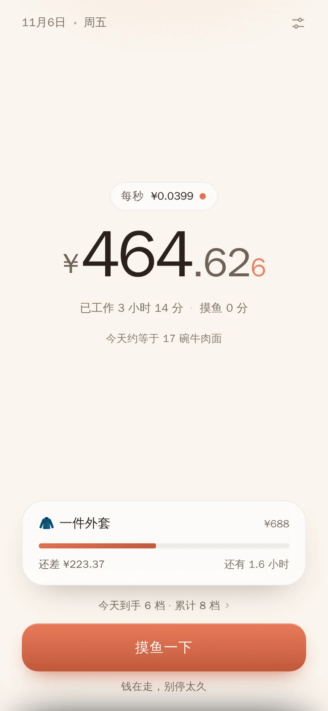
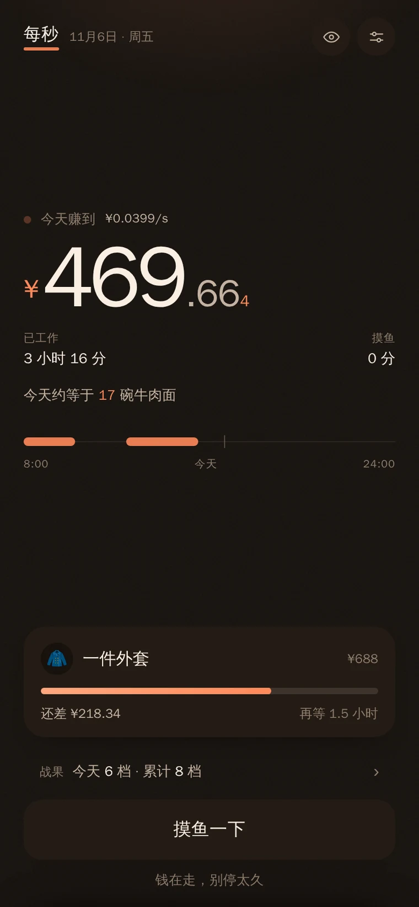

# 每秒 · Earn Tick

> 看着数字走，比看着时钟走舒服一点。

一个只有几个文件的 PWA：把你今天的收入换算成**每秒进账**，实时累加。
工作的时候时间过得很慢，但钱是按秒进来的——这个页面只做一件事，把这件事显示出来。

<p align="center">
  
  
</p>

## 它长什么样

- **主数字**：今天到目前为止赚了多少，小数第三位是橙色的，一直在动
- **每秒速率**：按你的月薪自动算出，一眼看到自己的价格
- **下一件想要的东西**：还差多少钱、还要多久，达成时有一小把纸屑和一次震动
- **一个按钮**：上班 → 摸鱼一下 → 继续搬砖。摸鱼的时长会如实记下来
- **今天的时段**：每工作一段就长出一个圆，越久圆越大——和 logo 是同一个形状
- **遮金额**：顶栏的眼睛图标一键把数字换成 `¥ ···`，截图时用

没有登录、没有云、没有排行榜、没有打卡。月薪只存在你自己的浏览器里。

## 人生类型

同样一笔钱，不同的人想买的东西不一样。设置里可以切换四种「人生类型」，
每套都有自己的物品目录和目标阶梯（换来换去不影响你已经攒下的账）。

阶梯不是写死的价格表，而是**八个「要干多久」**：5 分钟、14 分钟、29 分钟、58 分钟、
1 小时 45 分、3 小时、5 小时、1.15 天。按你的日薪把每个刻度换算成钱，再从目录里挑价格最接近的那件。

所以月薪六千和月薪十万看到的是两条不同的路，但节奏一样——第一档随手可及，最后一档要干满一整天：

| 月薪 | 第一档 | 最后一档 |
| --- | --- | --- |
| 6,000 | 一瓶水 | 一双帆布鞋 |
| 25,000 | 一杯冰美式 | 一天房租 |
| 100,000 | 一杯奶茶加料 | 一台笔电 |

目录里都是真东西：饮料、面、外卖、耳机、手机、笔电、相机；旅行的青旅、租车、海景房、机票；
居家的香薰、铸铁锅、咖啡机、洗碗机、沙发；游戏的十连、手柄、显示器、显卡、主机。

在设置里改月薪会被当成**加薪**处理：弹一张卡，告诉你涨了多少、阶梯从哪挪到哪，
并且如实说明今天已经攒下的会按新数字重算一遍。

## 战果

主界面下方一行小字：`今天到手 6 档 · 累计 8 档 ›`。点开是按阶梯顺序兑换的清单——
从第一档开始，攒够就换一件，换完往上走，一轮走完再从头。所以件数和金额永远对得上，
也跟目标卡的「还差多少」是同一套账。

## 模拟人生

设置 → 时间 → 模拟人生：选**工作几年**（1–40）和**多少倍速**（×60 / ×600 / ×3600 / ×86400），
页面按新速率往前推，主数字、目标、战果全部跟着走，跑满年限自动收尾。

- ×3600 = 现实 1 秒走过 1 个工时小时
- 模拟只在页面开着时推进，离开自动暂停（不然挂一晚上就"工作"了几十年）
- **模拟赚的钱不进真实账本**，两边是两本账

默认永远按真实时间走，模拟只是可选的另一双眼睛。

## 存档

- 每 1.5 秒、切后台、关页面都会存一次，按时间戳结算，关掉再打开金额是对的
- 冷启动（离开超过 2 分钟）顶部会出一条 `上次停在 15:28 · ¥359.20`，可以选择**继续**或**从头开始**
- 设置里还有：重置今天 / 从头开始 / 回到上一份（重置前自动备份一份，可以反悔）

## 分享：四档，自己挑

战果面板里可以导出一张**单文件 HTML**（内联样式、内联图标、零外部请求，约 4KB），
发给自己或朋友，双击就能看，末尾带项目地址。

| 档 | 卡面 | 含金额 | 含工时 |
| --- | --- | --- | --- |
| 一句话 | 「今天够买约 22 碗牛肉面」 | ✗ | ✗ |
| **战报**（默认） | 档位 + 件数清单 | ✗ | ✗ |
| 账单 | 累计/今天金额 + 每件折合 | ✓ | ✗ |
| 节奏卡 | 今天的时间块 + 段数 | ✗ | 只给时间结构 |

件数 ≥4 会写成「约 N」（取整到 5），金额取整到十位并加 `≈`——即使每天发一张，也拼不出精确数字。

## 特性

- **单个 HTML**：无框架、无构建、无依赖，打开就能跑
- **纯本地**：数据只在 `localStorage`，不联网、不上报、没有后端
- **关掉也不丢**：按时间戳结算而不是靠页面常驻，回来看到的是正确金额
- **可加到主屏**：manifest + service worker，离线可用
- **自动夜间模式**：20 点后自动转暖黑
- **版式**：纸感底色、占满屏宽的数字、圆角卡片；橙色只做强调，不用渐变和毛玻璃
- **手感细节**：状态点每秒跳一次、达成目标撒纸屑 + 震动、数字进位有轻微弹动

## 隐私

这个产品的核心数字就是收入，所以有几条硬规矩：

1. **不出网**：没有后端、没有统计、没有字体 CDN。CI 会拦住任何第三方域名、外部脚本，以及 `fetch` / XHR / beacon 这类网络调用。
2. **钱与工时永不同框**。工资 = 金额 ÷ 工时，这两个数只要同时出现在一张卡上，任何人都能一步算出你的时薪；只出现其中一个就推不出来。CI 里有一条检查专门守这个。
3. **件数是金额的马甲**：`×2 房租` 和 `¥2,580` 是同一句话。所以「战报」不给工时，「节奏卡」不给钱。
4. **取整与「约」**：单张卡里的精确值也能被多张卡差分出来，所以对外只给粗粒度。
5. **分享是快照**：文件里只有导出那一刻的数字，不带回调、不带 id。
6. **一键遮金额**：顶栏眼睛图标把主数字、速率、目标价、战果档位全部换成 `·`，方便截图。
7. 数据只有一份，在你自己浏览器的 `localStorage` 里，删掉这个站点的数据就等于彻底删除。

## 快速开始

本地跑起来只需要一个静态服务器：

```bash
git clone https://github.com/imkida/earn-tick.git
cd earn-tick
python3 -m http.server 8000
# 打开 http://localhost:8000
```

> 直接双击 `index.html` 也能用，但 service worker 和「添加到主屏幕」需要 http(s)。

在线版：**https://imkida.github.io/earn-tick/**

部署到任何静态托管都可以（GitHub Pages / Vercel / Netlify / Nginx / Caddy），
全部是相对路径，放在子目录也没问题。Caddy 示例：

```caddy
handle /earn* {
    root * /var/www/earn-tick
    uri strip_prefix /earn
    file_server
}
```

## 怎么算的

```
每秒进账 = 月薪 ÷ (每月工作日 × 每天工时 × 3600)
今日已赚 = 每秒进账 × 今天的工作秒数        # 暂停的时长不计
```

例：月薪 25000、每月 21.75 天、每天 8 小时 → **每秒 ¥0.0399**。

## 一些设计上的取舍

- **不做数据看板**：一屏只有数字、目标、按钮。多一个图表就多一分"又在一个仪表盘里"的感觉
- **不做账号**：这件事不需要云，也就不需要登录
- **不催你**：没有连续打卡、没有排行榜；摸鱼不会被批评，只会被记下来
- **第三位小数故意做橙色**：按秒结算时，它是唯一动得够快、能让人感知到"在赚"的东西
- **目标用实物而不是金额**：`还差 ¥11.55` 很难有感觉，`还差一点就够一杯手冲` 才有
- **阶梯最后一档约等于一天的收入**：太高就永远摸不到，太快就没有等待感

## 路线图

- [ ] 周 / 月聚合卡（顺手解决多张卡之间的差分问题）
- [ ] 目标阶梯自定义
- [ ] 中英文界面切换

有想法就开 issue。

## 已知限制

- 口径只有「月薪 × 工时」，不含奖金、年终、股票、副业
- 跨天自动清零；跨时区未特殊处理
- iOS 需要"添加到主屏幕"才是真正的全屏体验
- 分享页是快照，不会随后续进度自动更新
- 节奏卡要靠页面开着跑过工作时段才有时间块，早期数据只有一段

## English

**Earn Tick** is a tiny PWA that shows how much money you're making *right now, per second*.
One big number, your rate, the next thing you're saving up for, and a single button.

- One HTML file. No framework, no build step, no dependencies.
- 100% local — your salary never leaves `localStorage`. No backend, no analytics.
- Survives being closed: earnings are computed from timestamps, not from keeping the page open.
- Four "life modes" (worker / traveler / home blogger / gamer) with their own reward ladders.
- A stats sheet that converts earnings into things you actually got, in ladder order.
- A simulation mode: pick how many years and how fast, watch a working life go by. Optional, and off by default.
- Shareable single-file HTML battle report — amounts only, never hours worked, so nobody can divide one by the other and back out your salary.

```bash
git clone https://github.com/imkida/earn-tick.git && cd earn-tick
python3 -m http.server 8000   # → http://localhost:8000
```

Formula: `perSecond = salary / (workdaysPerMonth × hoursPerDay × 3600)`.

## License

[MIT](LICENSE) © imkida
